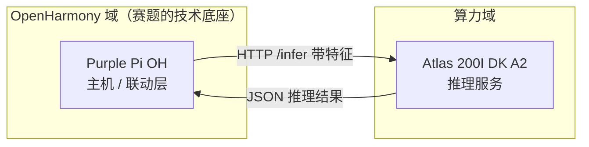

# 昇腾接入说明

> 回答一个问题：Atlas 200I DK A2 到底接在哪一环，代码改哪里。

---

## 一、位置：不在链路中间，在主机旁边

```
                    ┌──────────────────────┐
                    │  Atlas 200I DK A2    │
                    │  纯推理服务           │
                    │  （Ubuntu，不是鸿蒙）  │
                    └──────────▲───────────┘
                               │ HTTP POST /infer
                               │ ← JSON 结果
                               │
[节点] ──星闪/Wi-Fi──> [Purple Pi OH 主机]
  ↑                    │
  │                    ├── 决策（本地规则 + 推理结果）
  │                    │
  └──下发指令──────────┘
```

**关键分工：Atlas 只输出「推理结果」，不输出「控制指令」。**

| 谁 | 负责什么 | 例子 |
|---|---|---|
| Atlas | 算 | 「PMV = 0.32」「活动度 = 静坐，置信度 0.94」 |
| Purple Pi | 决策 | 「PMV > 0.5 → 开风扇；否则开空调」 |
| 节点 | 执行 | 「收到 CMD,LIGHT,1 → 继电器吸合」 |

**为什么要这么切**：

- 决策规则会**频繁改**（演示时调阈值、调策略），改决策不该重新部署模型
- 模型会**迭代**（换结构、重新训练），换模型不该动决策代码
- 切在这一刀上，两边可以独立开发、独立调试

---

## 二、为什么必须是这个位置（一个容易踩的架构错误）

**不能把 Atlas 当主控。**

Atlas 200I DK A2 跑的是 Ubuntu / openEuler，**不是 OpenHarmony**。而赛题要求「以开源鸿蒙操作系统为技术底座」——所以设备发现、分布式联动、控制下发这些必须留在 OpenHarmony 设备上（Purple Pi OH）。

Atlas 的角色只有一个：**提供算力**。它不参与 OpenHarmony 的分布式组网，也不做设备管理。



---

## 三、物理连接

| 设备 | 怎么连 |
|---|---|
| Purple Pi OH | 网线 → 交换机 / 路由器 |
| Atlas 200I DK A2 | 网线 → **同一台**交换机 / 路由器 |

**给 Atlas 配固定 IP**，别用 DHCP——否则重启后 IP 一变，主机端配置就得跟着改，演示当天最容易出这种事。

没有交换机可以网线直连，但两边要手动配到同一网段。

---

## 四、接口设计

一个 HTTP 接口就够。

```
POST http://<atlas-ip>:8080/infer
```

**请求**（主机 → Atlas）：

```json
{
  "node": "N01",
  "ts": 123456,
  "temp_c": 25.43,
  "rh": 58.12,
  "occupied": 1
}
```

**响应**（Atlas → 主机）：

```json
{
  "ok": true,
  "infer_ms": 8.3,
  "pmv": 0.32,
  "activity": "sitting",
  "confidence": 0.94
}
```

`infer_ms` 一定要带上，答辩时要用（证明推理真的在 NPU 上跑）。

**为什么用 HTTP + JSON 而不是 gRPC / 共享内存**：

- `curl` 一条命令就能测，调试成本最低
- 两端语言不必一致
- 500 ms 一次的请求频率，HTTP 的开销完全可接受

---

## 五、代码改在哪里

**只改主机端（Purple Pi）的决策模块，节点侧一行都不用动。**

```
hardware/host/purple_pi_host/
├── infer_client.c      ← 新增：HTTP 客户端
└── decision.c          ← 只改这一个文件
```

```c
/* 改之前（阶段 3）：本地阈值判断 */
if (sample.temp_c > CONTROL_TEMP_HIGH) {
    light = 1;
}

/* 改之后（阶段 5）：用推理结果做决策 */
InferResult r;
if (InferClientCall(&sample, &r) == 0) {
    target_pmv = r.pmv;                    /* 拿昇腾算出来的 PMV */
} else {
    target_pmv = pmv_local(sample.temp_c, sample.rh);  /* 降级：本地算 */
}

if (target_pmv > PMV_COMFORT_HIGH) {
    fan_level = 3;                         /* 先动低功耗手段 */
}
```

**记得留降级开关**：昇腾不可达时自动退回本地计算，演示不中断。这既是工程习惯，答辩时也能当亮点讲。

**节点侧零改动**——`udp_link.c` 报什么、`sensor_node.c` 干什么，跟昇腾完全无关。这就是当初把通信层和业务层分开的价值。

---

## 六、接入步骤（按这个顺序，别跳）

### 第 0 步 · 先证明「能调用」，别管模型（半天）

**最容易犯的错：先花一周训模型，最后发现两边网络根本不通。**

所以第一步是：

1. Atlas 上跑一个**假服务**——Python Flask，硬编码返回 `{"pmv": 0.3, "infer_ms": 0.0}`，**不加载任何模型**
2. 主机上用 `curl` 打通
3. 确认网络、端口、防火墙都 OK

```bash
curl -X POST http://192.168.1.50:8080/infer \
     -H 'Content-Type: application/json' \
     -d '{"node":"N01","temp_c":25.4,"rh":58.1,"occupied":1}'
```

这一步跑通了，后面才有意义。

### 第 1 步 · 模型转 `.om`（1~2 天）

```bash
atc --model=model.onnx --framework=5 \
    --output=model \
    --soc_version=Ascend310B1 \
    --precision_mode=allow_mix_precision \
    --input_format=ND \
    --input_shape="input:1,6"
```

**转完必须做精度比对**：同一个输入分别喂给 ONNX 和 `.om`，输出余弦相似度要 > 0.99。不做这一步，会出现「转换成功但结果全错」这种最难查的问题。

> ⚠️ **不要碰 MindIE**。官方支持硬件列表里**不包含 Ascend 310B**（Atlas 200I DK A2）。老老实实走 `ATC + AscendCL` 这条成熟路径。
>
> ⚠️ **不要用动态 shape**。输入长度在导出时就固定死，服务层做 padding / 切窗。

### 第 2 步 · 真服务替换假服务（1~2 天）

用 AscendCL 加载 `.om`，外面包一层 HTTP：

```
收到请求 → 组装输入张量 → aclmdlExecute() → 取输出 → 返回 JSON
```

同时把**真实的推理耗时**填进 `infer_ms`。

### 第 3 步 · 主机端接入

写 `infer_client.c`，在 `decision.c` 里调用它，带降级开关。

---

## 七、答辩时的三个证据（缺一不可）

| 证据 | 怎么留 |
|---|---|
| `atc` 转换命令与完整日志 | 转换时直接重定向到文件 |
| ONNX 与 `.om` 的精度比对结果 | 写个脚本跑一遍，存输出 |
| `npu-smi info` 的实时利用率 | 推理过程中截图 |

这三样是回答「你的 AI 到底跑在哪」的唯一硬证据。**没有它们，讲得再好也可疑。**

---

## 八、一句话总结

> 昇腾不替换任何东西，它是**挂在 OpenHarmony 主机旁边的一个推理服务**。主机问它「这组数据意味着什么」，它答一个数，**决策权始终在鸿蒙这一侧**。
